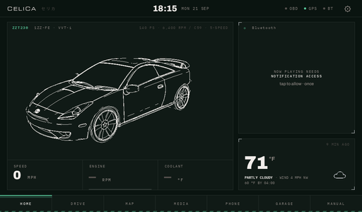
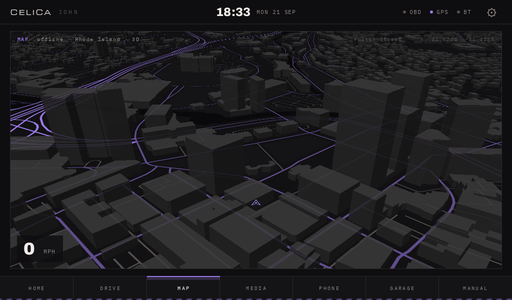
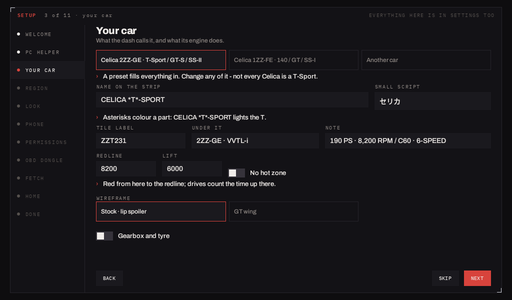
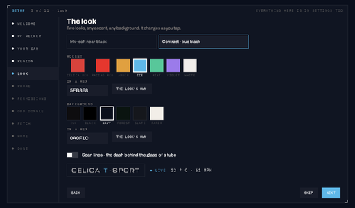
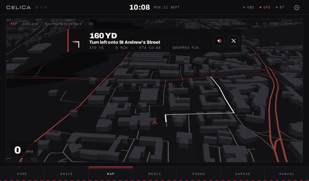
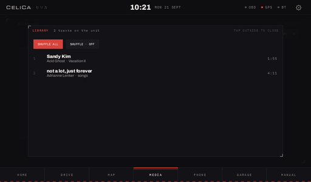

# Celica Dash

A launcher for the Android head unit in your car: gauges straight off the engine, an offline map
with turn-by-turn, your music, your phone, the fusebox and the workshop manual — all dressed as
one thing. Written for a 2003 Celica; set up for yours in a few minutes.

  
  

## What you need

- **An Android head unit** — any make, Android 9 or newer, landscape. The common budget "QF" units
  (a *Factory settings* menu, zlink for CarPlay) get everything; any other unit gets everything
  except the CarPlay curtain.
- **A Windows PC or a Mac** with Python 3 (Windows: `RUN ME.cmd` installs it for you).
- **One Wi-Fi for both.** The unit fetches everything from the PC — park near the house, or take
  a laptop to the car on your phone's hotspot.
- *Optional:* a cheap Bluetooth ELM327 OBD dongle for the engine gauges; your MP3s.

## Install — four steps

1. **Download** the latest `CelicaDash-Setup-vX.zip` from [Releases](../../releases) and unzip it.
2. **On the PC:** double-click `RUN ME.cmd` (Mac: `RUN ME.command`). A wizard opens in your
   browser. Answer its pages — your car, where you drive, colours, your phone — and let it make
   the offline map and pack your music. That's the typing-heavy part, done where there's a
   keyboard.
3. **On the unit:** open its web browser and type the address the wizard's *Install* page shows.
   Tap the download to install. (Android asks once to allow installs from the browser — say yes.)
4. **Open Celica Dash.** Its own short Setup finds the PC by itself, takes your answers, and
   fetches the map and music. Grant what it asks; make it the Home app on the last page.

Nothing is final — every answer is in the dash's **Settings ⚙** again, and RUN ME can be run any
time to update the map or add songs. The full guide is `README.html` in the zip (and on the
wizard's last page): three ways to install, every page explained, troubleshooting.

  
  

## What it does

- **Drive** — six faces for the engine (tach, sweep, numbers, track, theatre, analogue), the lift
  zone on a 2ZZ, gear readout, drive recording and replay, a ghost of your best run.
- **Map** — offline, 3D, heading-up, from OpenStreetMap for the region you pick. Hold a spot to
  pin it; GO for spoken turn-by-turn. Fuel stops and places on the map and in the search.
- **Media** — what the phone plays over Bluetooth, and a Library of your own songs the dash plays
  itself, with cover art.
- **Phone** — pairing, calls, and a CarPlay / Android Auto button. On QF units the dash covers
  zlink's connect screen with its own and can end a session cleanly.
- **Garage** — fusebox, service log, specifications, checklist. **Manual** — the workshop manual,
  searchable, every page a figure you can pinch.
- **Yours** — car name and labels, 2ZZ / 1ZZ / other engine, stock or GT-wing wireframe, any
  accent and background, miles or kilometres, the voice's language, iPhone or Android.

  
  

## Honest notes

- Written on and for a ROCO K706 (QF firmware, Android 10, 1024×600). Other units are expected to
  work — the dash asks the unit what it is and adapts — but have not been tried. The guide's
  *"What has been tried where"* table says exactly what has.
- Android Auto through the curtain has not been tried on a real phone.
- The map covers only the region you pick; a state or county is minutes, a country an hour.

## Building it yourself

`android/` is the app (Kotlin + Compose; see `android/README.md`), `setup/` the PC helper and
wizard, `pack/celica/` the car pack, `tools/` the things that make the pack and the routing tool.
`python make_release.py` builds the APK and the Java tool and zips the distributable.

## Licence

MIT for the code — see `LICENSE`. Map data © OpenStreetMap contributors (ODbL); the libraries and
data it stands on are listed in `LICENSES/`. The workshop manual pages in the Celica pack are
Toyota's, included for personal reference.
